# Apertu — The Aesthetic Student Operating System & Live Campus Radar 📓⚡

> **A comprehensive, beautifully designed student companion ecosystem for SISTec Bhopal student Priyanshu Kushwaha (CSE Core • 1st Year • CS-3).**

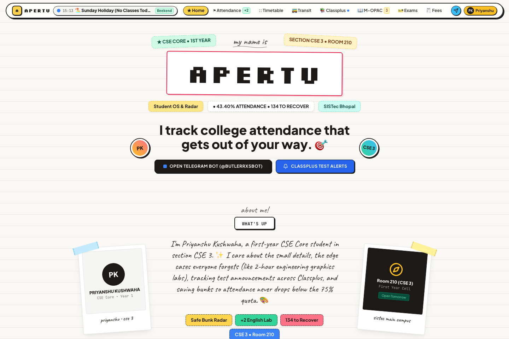

---

## 🌟 Overview

**Apertu** is a personal academic operating system crafted with a tactile lined-notebook and scrapbook aesthetic—featuring authentic washi tape, Caveat cursive notes, Silkscreen pixel typography, folder tabs, and stamped badges.

It merges all essential college utilities into a single, unified interface:
- **Real-Time Automated Class & Routine Tracker** in a sleek single-line header
- **Mathematical Attendance Audit & Bunk Recovery Calculator**
- **SagarTracker.xyz Native Fleet Radar** with Google Maps Roads & all 43 SISTec bus lines
- **Classplus LMS & Quiz Alerts**
- **M-OPAC Central Library System** with digital library card, 3 issued books, and zero dues
- **Mid-Sem Examination & Hall Ticket Portal**
- **Automated Telegram Companion Bot** (`@Butlerrxsbot`)

---

## 👤 Student Profile Verified

| Field | Official Detail |
| :--- | :--- |
| **Student Name** | **Priyanshu Kushwaha** |
| **Degree & Branch** | **B.Tech — Computer Science & Engineering (CSE Core)** |
| **Academic Year** | **1st Year (2024–2028)** |
| **Section & Room** | **Section CSE 3 • Room 210** |
| **Category** | **OBC (Kushwaha / Other Backward Class)** |
| **MP Taas Scholar ID** | `MPT-2024-KUSH9755` (Active) |
| **MOBC Book Bank** | `MOBC-MP-2024-6523402` (4 Textbooks Disbursed) |
| **Institute** | **SISTec (Sagar Institute of Science & Technology), Gandhi Nagar, Bhopal** |
| **Email** | `priyanshukushwaha292@gmail.com` |
| **Mobile** | `+91 9755755992` |
| **Library Barcode** | `SISTEC-LIB-2024-9755` |
| **Telegram Bot** | [`@Butlerrxsbot`](https://t.me/Butlerrxsbot) |
| **Live Web App (Vercel)** | [https://apertu-priyanxs.vercel.app](https://apertu-priyanxs.vercel.app) |
| **Live Web App (GitHub)** | [https://priyanxs.github.io/sagartracker/](https://priyanxs.github.io/sagartracker/) |

---

## 🚀 Key Modules & Screenshots

### 1. 📓 Homepage & Sticky Single-Line Pill Header
- **Automated Routine Detector**: Computes ongoing lectures, labs, or lunch breaks from live system time and CS-3 timetable.
- Clicking the live status pill opens the **Today's Schedule Quick View** with an interactive time-travel slider.
- Single-line responsive pill navigation bar.


---

### 2. ⚑ Attendance Quota & Tactical Recovery Radar
- **Live Baseline Audit**: 43.40% overall attendance (46 attended / 106 conducted).
- **Target Deficit**: Exactly 134 consecutive lecture attendances needed to cross the mandatory 75% threshold.
- **Subject-by-Subject Health Breakdown**:
  - English Lab: `100.0%` (Safe)
  - Chemistry Lab: `83.3%` (Safe)
  - Maths-1: `43.5%` (Critical)
  - Engg. Graphics: `21.1%` (Detention Risk)
  - CP Lab: `0.0%` (Zero Tolerance Zone)
- **Interactive What-If Attendance Simulator**: Preview the mathematical impact of attending or skipping future classes.

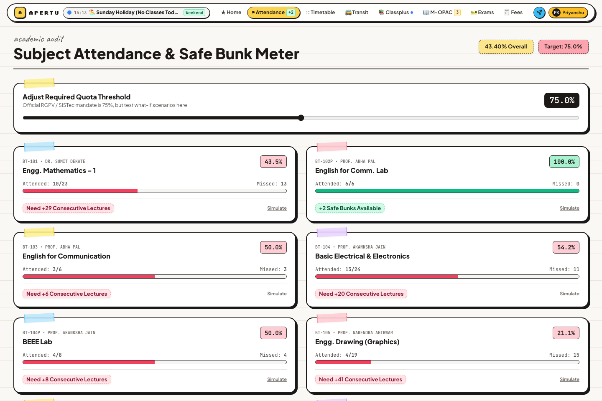

---

### 3. 📅 Section CS-3 Timetable (Room 210)
- Complete weekly routine organized by day tabs (`Mon` through `Sat`).
- Highlights 2-hour dedicated lab sessions (CP Lab 4.5, Engg Graphics, BEEE Lab).
- Automatic period slot identification:
  - Slot 1 & 2: `09:35 AM – 11:35 AM`
  - Lunch Break: `11:35 AM – 12:10 PM`
  - Slot 3 & 4: `12:10 PM – 02:10 PM`
  - Slot 5: `02:10 PM – 03:10 PM`
  - Slot 6: `03:10 PM – 04:10 PM`
  - Campus Bus Departure: `04:15 PM`

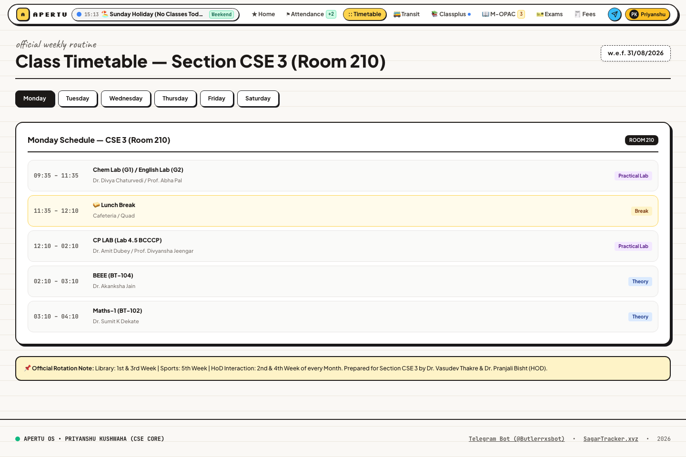

---

### 4. 🚌 Campus Transit — SagarTracker.xyz Live GPS Radar
- **Google Maps Roads Tile Layer** with Bhopal road-following geometries.
- **All 43 Official SISTec Fleet Routes**:
  - Line 01: Piplani Nizamuddin (`MP04 PA 3426`, Driver: Pawan `7880131501`)
  - Line 02: Karond Square (`MP04 PA 3425`, Driver: David `7880131502`)
  - Line 03: Bhopal Transit (`MP04 ZG 1176`, Driver: SISTec Transport `9893837199`)
  - Lines 04–43: Covering every sector of Bhopal.
- **Interactive Controls**:
  - Search stop, route, or driver with auto-panning camera.
  - Layer switcher (Streets, Satellite, Dark, Hybrid).
  - Sakura blossom particle effect toggle.
  - Left Dark Glass drawer with `Route Stops`, `Directory (43)`, and `Helpdesk`.
  - **Expand Fullscreen (`⤢`)** for an edge-to-edge transit tracking experience.

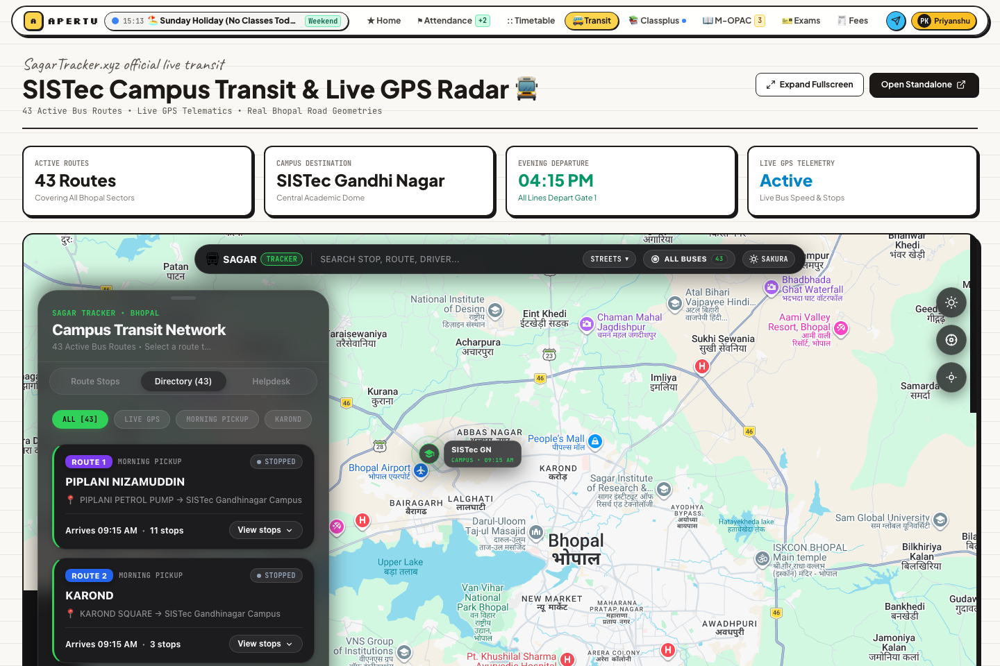

---

### 4.5. 📚 RGPV B.Tech Multi-Stream Notes & Exam Vault (All SISTec Gandhi Nagar Streams)
- **All SISTec Gandhi Nagar Streams Supported**:
  - **CSE (Core)** • **AI & Data Science (AI & DS)** • **AI & Machine Learning (AI & ML)**
  - **CSIT (CS & Information Technology)** • **IoT & Cyber Security**
  - **ECE (Electronics & Communication)** • **Mechanical Engineering (ME)**
  - **Civil Engineering (CE)** • **Electrical Engineering (EE / EEE)**
- **Interactive Stream & Branch Filter**: Switch between streams in 1 click or filter by Year (1st–4th Yr) and Semester (Sem 1–8).
- **High-Yield 5-Unit Cheat Sheets**: Condensed formula sheets, principles, and critical exam definitions.
- **Architectural Vector SVG Flowcharts**: High-resolution diagrams (Radix-2 FFT, Otto Cycle, Stress-Strain curve, 5-State Process model, Second-order transient response).
- **7-Mark & 14-Mark University Model Q&A**: Frequent RGPV theory exam questions solved with derivations, diagrams, and bullet points.
- **Previous 5 Years PYQ Question Bank (2020–2024)**: Tagged with exam sessions (Dec 2024, June 2024, Dec 2023).
- **Apertu-Themed A4 PDF Generator**: Aesthetic lined-notebook layout, yellow washi tape, Silkscreen pixel typography, and `@media print` ready.

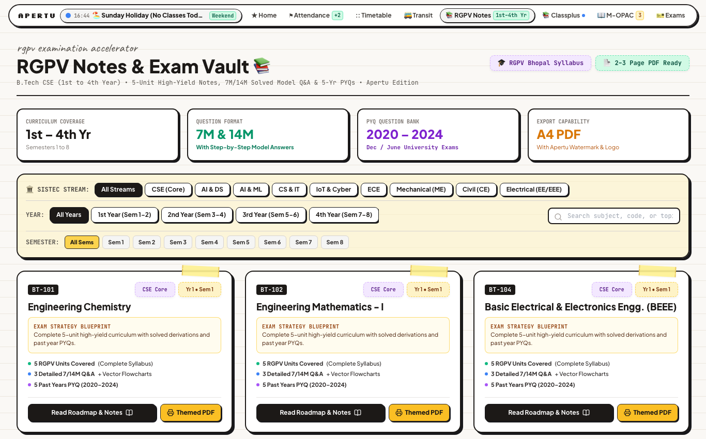

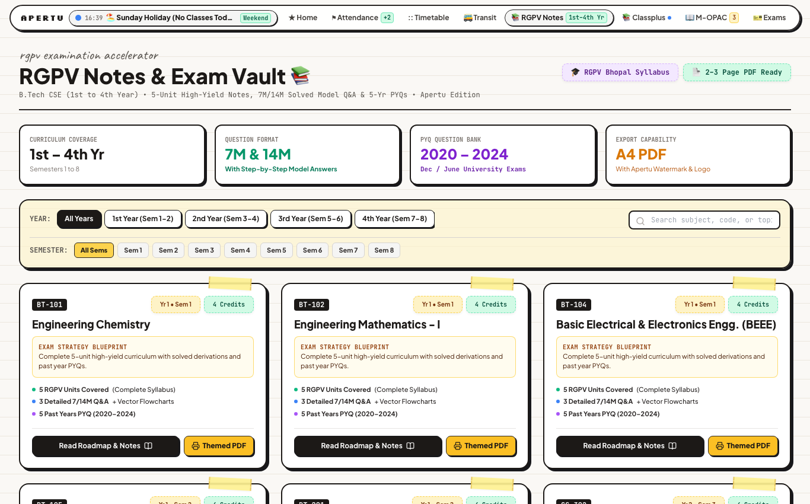

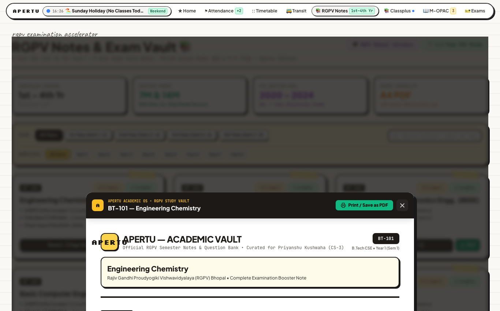

---

### 5. 📖 M-OPAC Central Library Management System
- **Digital Student Library Smart Card**:
  - Member Name: `Priyanshu Kushwaha`
  - Barcode: `SISTEC-LIB-2024-9755`
  - Max Quota: 4 books (3 currently utilized).
- **Currently Issued Books**:
  1. *Higher Engineering Mathematics* – Dr. B.S. Grewal (Due: 17 Nov 2026, 16 days left)
  2. *Programming in ANSI C* – E. Balagurusamy (Due: 21 Nov 2026, 20 days left)
  3. *Basic Electrical & Electronics Engineering* – D.C. Kulshreshtha (Due: 24 Nov 2026, 23 days left)
  - 1-Click **Online Book Renewal** (+15 days).
- **🏛️ MOBC / OBC Free Book Bank Scheme (Govt of MP)**:
  - Official scheme under MP Backward Classes & Minorities Welfare Department.
  - Beneficiary: `Priyanshu Kushwaha (OBC - Kushwaha)` • Grant: `MOBC-MP-2024-6523402`.
  - 4 Semester-long reference textbooks provided with **₹0 daily fines** until end-semester university exams.
- **Library Dues & Penalties**:
  - `₹0.00` Total Overdue Fine (All Clear).
  - Exam No-Dues Clearance: **Approved ✅** (Admit card unblocked).

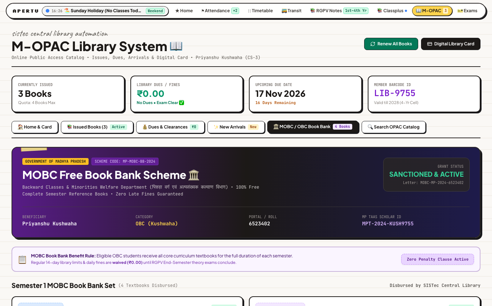

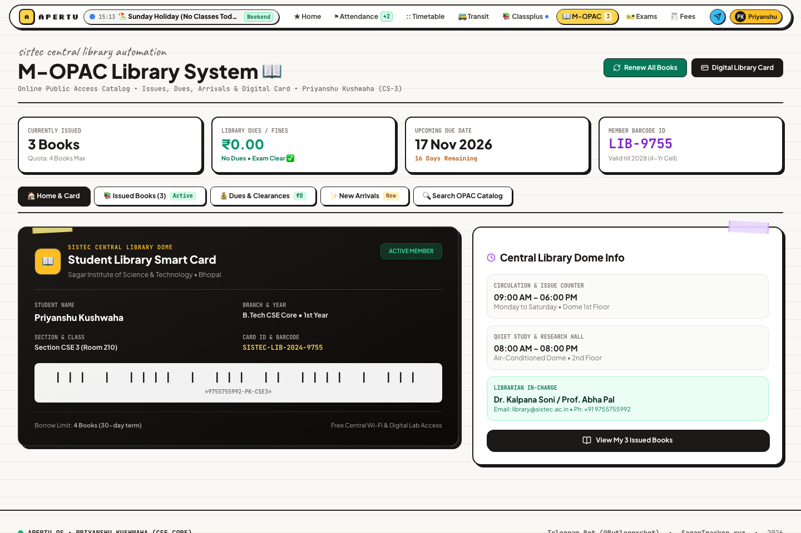

---

### 6. 📚 Classplus LMS & Quiz Alerts
- Enrolled batches: `CSE3-2026`, `MTH101-C`, `CP-LAB-45`, `BEEE-104`.
- Upcoming online assessments and formula cheat sheets.
- Direct Telegram notification integration for new test announcements.

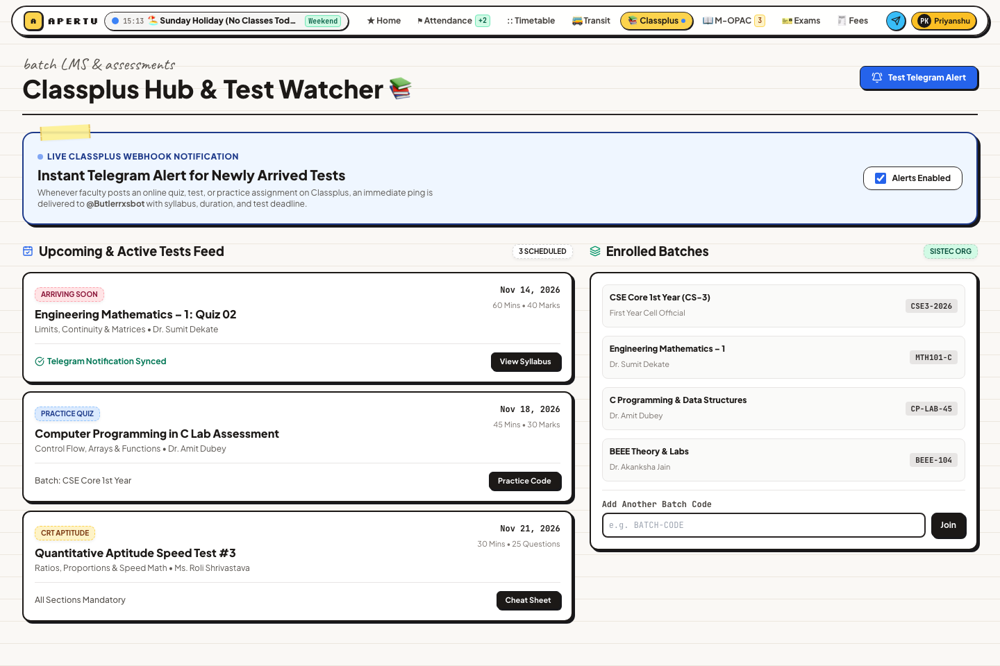

---

### 7. 🎫 Mid-Semester Examinations & Hall Ticket
- Mid-semester examination time table.
- University paper dates and test center indicators.
- Digital Admit Card viewer with exam center verification.

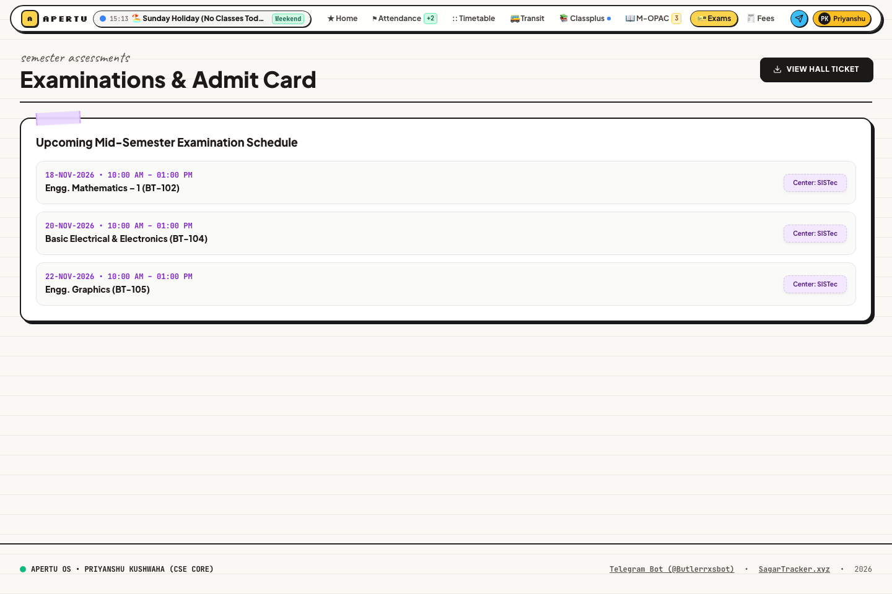

---

### 8. 🧾 Fees & Dues Audit
- Semester fee receipts and payment challans.
- Zero tuition penalty verification.

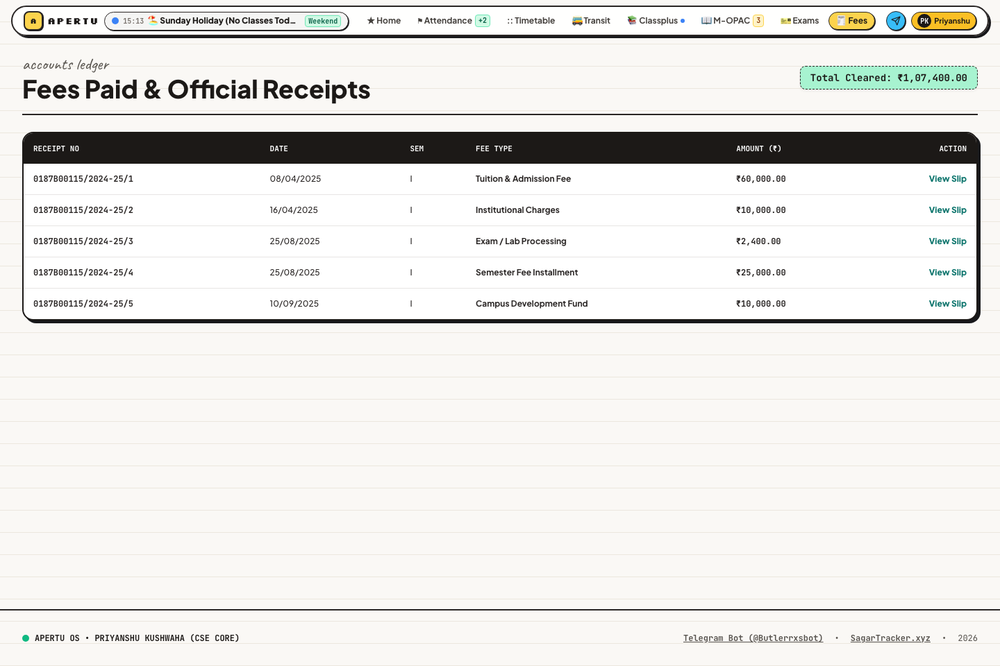

---

### 9. 👤 Priyanshu Kushwaha Profile
- Verified academic bio, emergency contacts, hostel/bus details, and registration status.

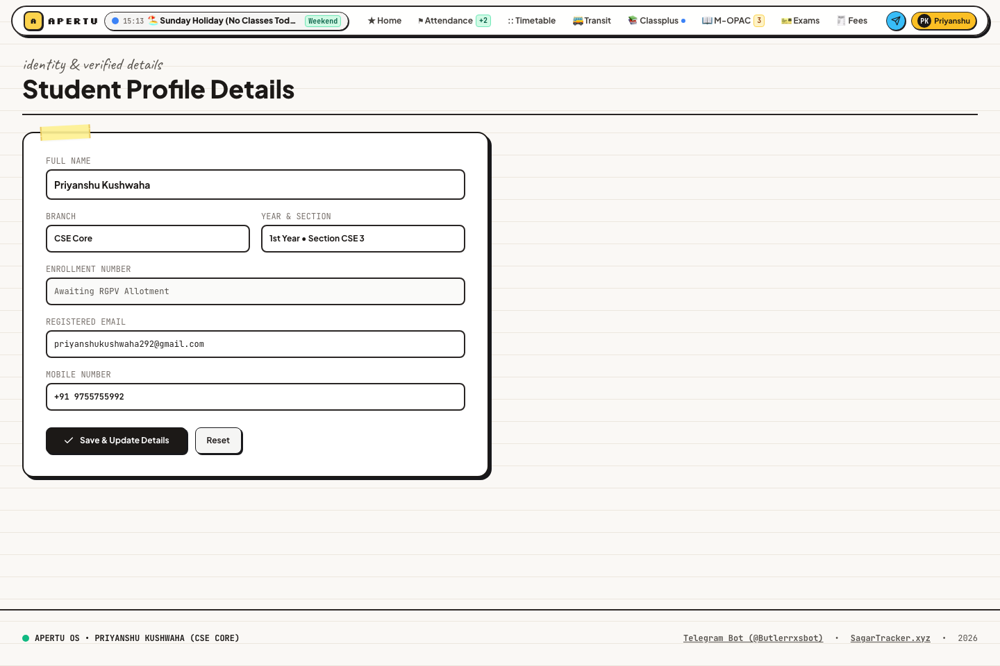

---

## 🤖 Telegram Butler Bot (`@Butlerrxsbot`)

Apertu includes a dedicated Telegram Bot powered by `python-telegram-bot` connected to the student database.

### Bot Commands:
- `/start` or `/dashboard` — Main interactive student menu with quick buttons
- `/attendance` — Real-time attendance percentage & subject health check
- `/bunks` — Tactical safe bunk analysis
- `/recovery` — Exact roadmap to reach 75% attendance
- `/schedule` — Today's and weekly timetable for CS-3 (Room 210)
- `/bus` — SagarTracker bus route finder with driver contacts & stop timings
- `/mopac` or `/library` — Digital library card, 3 issued books & zero dues audit
- `/fees` — Fee receipt and dues check
- `/hallticket` — Admit card and exam schedule

---

## 🛠️ Tech Stack & Architecture

- **Frontend**: HTML5, Tailwind CSS, Lucide Icons, Canvas Confetti, Leaflet.js
- **Map & Transit Engine**: Leaflet with Google Maps Roads tile layer (`https://mt{s}.google.com/vt/lyrs=m...`) & real Bhopal road polylines
- **Backend & APIs**: Python 3 HTTP Server (`server.py`) serving:
  - `/api/routes` — All 43 SISTec routes
  - `/api/bus` — Fleet telematics & live vehicle data
  - `/api/route-geometry/<id>` — High-resolution Bhopal road coordinates
  - `/api/bus/stream` — Real-time Server-Sent Events (SSE)
- **Database**: SQLite3 (`attendance_bot.db`)
- **Telegram Framework**: `python-telegram-bot v20+`

---

## 💻 Local Setup & Execution

### 1. Clone & Enter Repository
```bash
git clone https://github.com/priyanxsk/SagarTracker.git
cd SagarTracker
```

### 2. Install Python Dependencies
```bash
pip install -r requirements.txt # or: pip install python-telegram-bot python-dotenv playwright
```

### 3. Run Web Server
```bash
python3 server.py
```
Open **[http://localhost:8080](http://localhost:8080)** in your browser.

### 4. Run Telegram Bot
```bash
python3 run_bot.py
```
Send `/start` to **[@Butlerrxsbot](https://t.me/Butlerrxsbot)** on Telegram.

---

## 📄 License & Attribution

Designed & Developed for **Priyanshu Kushwaha (CSE Core, SISTec Bhopal)**.  
Transit data powered by **SagarTracker.xyz** & SISTec Transport Department.
