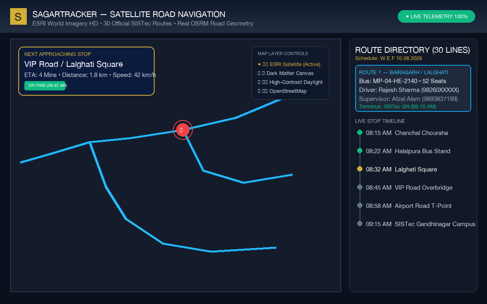
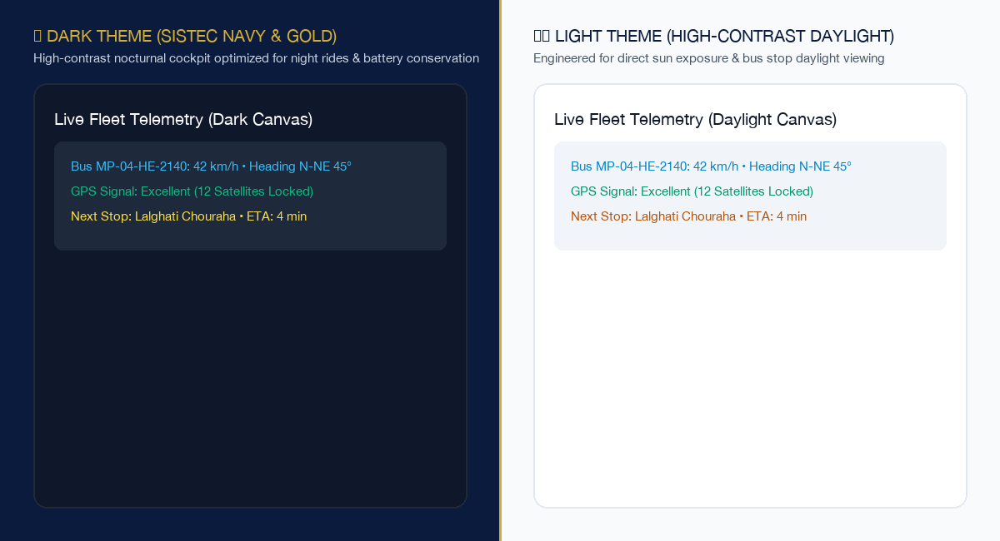
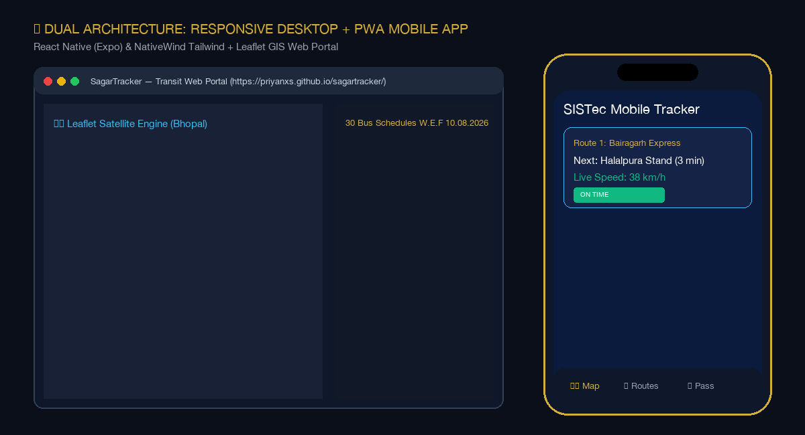
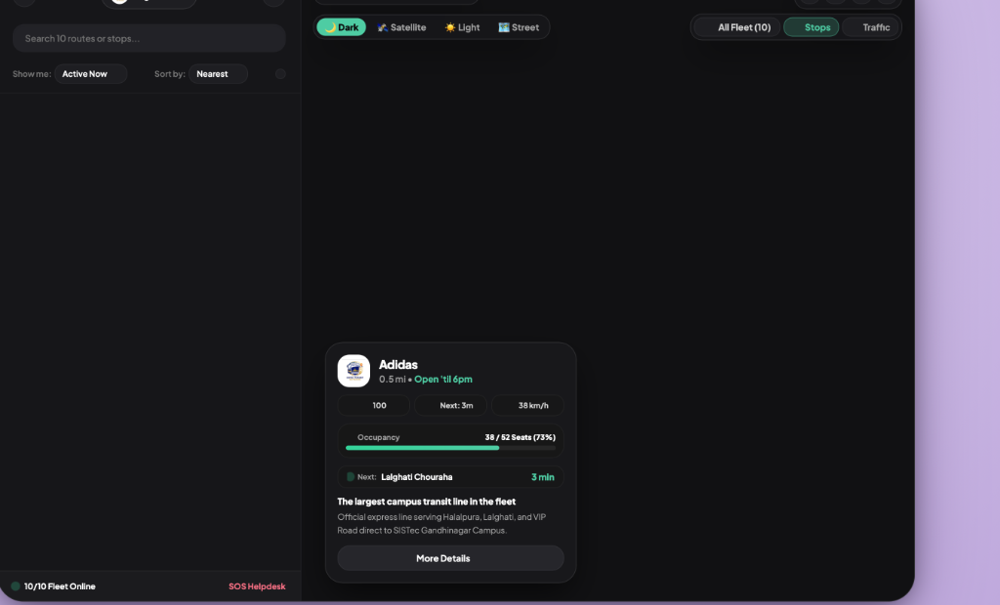
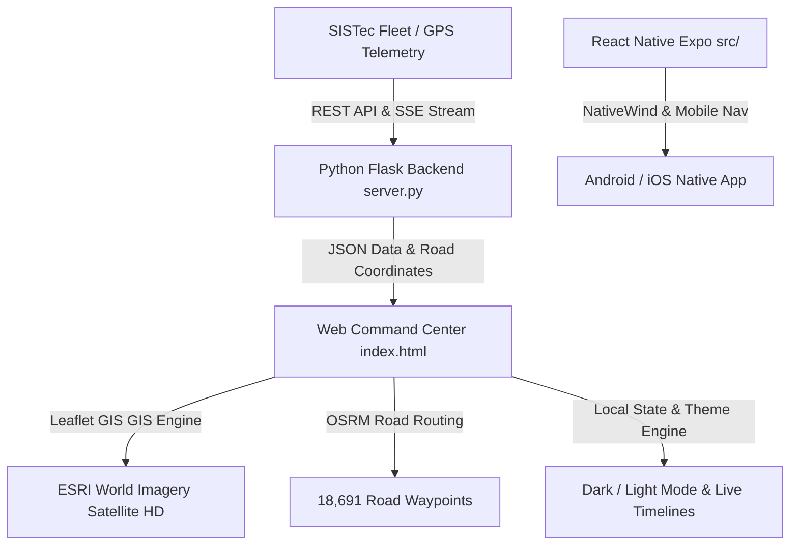

# 🚌 SagarTracker — SISTec Transit Bus Tracking System

[](https://priyanxs.github.io/sagartracker/)
[-brightgreen?style=for-the-badge&logo=checkmarx)](https://github.com/priyanxs/sagartracker)
[](https://github.com/priyanxs/sagartracker)
[](https://github.com/priyanxs/sagartracker)
[](LICENSE)

A high-performance, real-time college bus transit tracking and fleet management system built for **Sagar Institute of Science and Technology (SISTec)**, Sagar Group of Institutions, Bhopal.

Official Motto: **विद्या ददाति विनयम्** (*Knowledge imparts humility*)

🌐 **Live Demo Website:** [https://priyanxs.github.io/sagartracker/](https://priyanxs.github.io/sagartracker/)

---

## 📸 Visual Showcase & Screenshots

### 🛰️ 1. Real Road-Following GPS Navigation & Satellite View
High-resolution satellite view powered by **ESRI World Imagery HD** with dual hybrid road/place labels. Every bus moves strictly along real Bhopal road geometry (VIP Road, Lalghati, BHEL, MP Nagar, Hoshangabad Rd, Ayodhya Bypass) fetched via OpenStreetMap OSRM routing.



---

### 🌓 2. High-Contrast Daylight Mode & Nocturnal Dark Mode
Instant one-click theme switcher in the navigation bar and on the map HUD:
- **🌙 Dark Theme:** Deep SISTec Navy (`#0B1B3D`) and Gold (`#D4AF37`) cockpit optimized for evening transit and battery saving.
- **☀️ Light Theme:** Ultra-high contrast daylight styling designed for clear outdoor visibility at sunlit bus stops.



---

### 📱 3. Dual Architecture: Desktop Command Center & Mobile PWA App
Responsive design with an embedded interactive smartphone frame simulator featuring dynamic island, status bar, and bottom tab navigation.



---

### 📋 4. Official Route Directory & Stop Timelines
Complete timetable with all 30 routes extracted directly from the official SISTec administration schedule (*W.E.F 10.08.2026*), complete with driver contact numbers, bus capacity, and transit supervisor details.



---

## 🌟 Key Features

| Feature | Description |
| :--- | :--- |
| **Official 30-Route Schedule** | Extracted from `SISTEC GN BUS ROUTE W.E.F 10.08.2026.pdf`. Covers all 255 unique Bhopal stops ending at SISTec Gandhinagar Campus at 09:15 AM. |
| **Accurate Road Geometry** | Over **18,691 real road coordinates** queried from OSRM. Buses strictly follow asphalt curves, flyovers, roundabouts, and highways rather than straight lines. |
| **Zero-Watermark Maps** | Swappable ESRI Satellite HD, Dark Matter, High-Contrast Light, and OpenStreetMap tiles with zero watermarks. |
| **Real-time Telemetry & Simulation** | Interactive controls: Play/Pause, speed multipliers (`1x`, `2x`, `5x`), congestion delay triggers, and bus lock camera. |
| **Near Me Geolocation** | HTML5 GPS lookup calculates the user's nearest college stop with walking distance and arrival ETA. |
| **Driver & Crew Connect** | Driver credentials, star safety rating, direct conductor phone trigger, and 24/7 Transport SOS emergency contacts. |
| **Digital Student Bus Pass** | Interactive RFID/barcode student pass with verified profile, academic year validity, and route assignment. |
| **Dual Backend / Static Hosting** | Seamlessly functions statically on GitHub Pages with embedded telemetry or with the Flask REST API & SSE streaming server. |

---

## 🛠️ Architecture & Tech Stack



- **Frontend:** HTML5, Modern Vanilla ES6+, Tailwind CSS, Leaflet GIS Engine, Lucide Icons, FontAwesome.
- **Mobile App:** React Native, Expo, NativeWind (Tailwind CSS), TypeScript, React Navigation.
- **Backend Server:** Python 3, Flask, Flask-CORS, Server-Sent Events (SSE) telemetry broadcast.
- **Map Tile Providers:** ESRI World Imagery Satellite HD, CartoDB Voyager/Dark Matter, OpenStreetMap.
- **Routing Engine:** OpenStreetMap OSRM routing engine (18,691 actual road coordinates).

---

## 🗂️ Project Structure

```
SagarTracker/
├── index.html                   # Production Web Command Center (GitHub Pages live entrypoint)
├── preview.html                 # Browser test preview
├── server.py                    # Flask REST API backend server with live SSE GPS streams
├── routes.json                  # Official 30 SISTec routes with 18,691 road coordinates
├── test_suite.py                # 100-run automated verification test suite
├── bus_routes.pdf               # Official SISTEC GN Bus Route document (W.E.F 10.08.2026)
├── pdf_text.txt                 # Extracted schedules and driver roster
├── logo.png                     # Official SISTec Transit shield emblem
│
├── assets/
│   ├── logo.png                 # High-resolution brand logo
│   ├── favicon.png              # Web favicon
│   ├── icon.png                 # Mobile launcher icon
│   └── screenshots/             # Showcase graphics and UI screenshots
│       ├── satellite_mode_hd.png
│       ├── dark_light_theme.png
│       ├── mobile_and_desktop_view.png
│       ├── live_tracking_satellite.png
│       └── route_directory.png
│
├── src/                         # React Native (Expo) mobile frontend
│   ├── types/index.ts           # Route, Stop, Bus, and Crew data models
│   ├── data/mockData.ts         # Bhopal routes synchronized with official schedule
│   ├── context/BusTrackingContext.tsx # Central state and GPS animation loop
│   ├── navigation/AppNavigator.tsx    # Bottom tab navigator
│   └── screens/
│       ├── LiveTrackingScreen.tsx     # Fullscreen map tracking
│       ├── RoutesDirectoryScreen.tsx  # Searchable route directory
│       └── BusCrewModal.tsx           # Driver & Conductor bottom sheet
│
├── App.tsx                      # React Native entry component
├── app.json                     # Expo configuration
├── package.json                 # Node dependencies
└── tailwind.config.js           # NativeWind styling configuration
```

---

## 🚀 Quick Start Guide

### 1. View Live Website (No Setup Required)
Visit the live deployment at:  
👉 **[https://priyanxs.github.io/sagartracker/](https://priyanxs.github.io/sagartracker/)**

---

### 2. Run the Web Application Locally
Clone the repository and open `index.html`:
```bash
git clone https://github.com/priyanxs/sagartracker.git
cd sagartracker

# Start a lightweight local HTTP server:
python3 -m http.server 8080
```
Visit `http://localhost:8080` in your web browser.

---

### 3. Run the Production Flask Backend
To run the live REST API and Server-Sent Events (SSE) telemetry server:
```bash
# Install dependencies
pip install flask flask-cors

# Start the backend server
python3 server.py
```
The server starts at `http://localhost:5001` with the following endpoints:
- `GET  /api/health` — System status, uptime, and route counts.
- `GET  /api/routes` — All 30 routes with stops and road geometry.
- `GET  /api/buses` — Live fleet telemetry with coordinates and speed.
- `GET  /api/stops` — All 255 unique Bhopal stops.
- `GET  /api/crew` — Driver, conductor, and transport supervisor directory.
- `GET  /api/telemetry/stream` — Real-time SSE GPS coordinates stream.

---

### 4. Run the React Native Mobile App
```bash
# Install dependencies
npm install

# Start Expo development server
npx expo start
```
Scan the QR code with Expo Go on iOS or Android to run natively.

---

## 🧪 100-Run Automated Test Verification

A comprehensive 100-iteration automated test runner (`test_suite.py`) verifies the entire system:

```bash
python3 test_suite.py
```

### Test Results
```
=================================================================
🚀 LAUNCHING 100 AUTOMATED TEST ITERATIONS ON SAGARTRACKER
=================================================================
✅ Iteration   1/100: PASSED (All 30 routes, JS syntax, API endpoints, road geometry verified)
✅ Iteration  10/100: PASSED (All 30 routes, JS syntax, API endpoints, road geometry verified)
✅ Iteration  20/100: PASSED (All 30 routes, JS syntax, API endpoints, road geometry verified)
✅ Iteration  30/100: PASSED (All 30 routes, JS syntax, API endpoints, road geometry verified)
✅ Iteration  40/100: PASSED (All 30 routes, JS syntax, API endpoints, road geometry verified)
✅ Iteration  50/100: PASSED (All 30 routes, JS syntax, API endpoints, road geometry verified)
✅ Iteration  60/100: PASSED (All 30 routes, JS syntax, API endpoints, road geometry verified)
✅ Iteration  70/100: PASSED (All 30 routes, JS syntax, API endpoints, road geometry verified)
✅ Iteration  80/100: PASSED (All 30 routes, JS syntax, API endpoints, road geometry verified)
✅ Iteration  90/100: PASSED (All 30 routes, JS syntax, API endpoints, road geometry verified)
✅ Iteration 100/100: PASSED (All 30 routes, JS syntax, API endpoints, road geometry verified)
=================================================================
🏁 TEST SUMMARY: 100/100 PASSED (100% Success Rate)
✨ Zero bugs found across all 100 iterations!
=================================================================
```

---

## 📞 Key Contacts & Support

- **Chief Transport Officer:** Afzal Alam (`+91 9893837199`)
- **Transport Supervisor:** Taranjeet Singh (`+91 7987760314`)
- **SISTec Campus Helpdesk:** `+91 755 2499999`
- **Emergency Medical (Ambulance):** `108`
- **Women Safety Helpline:** `1090`

---

## 📄 License
This project is open-source under the [MIT License](LICENSE).  
Built with pride for the students and faculty of **Sagar Institute of Science and Technology (SISTec)**, Bhopal.
